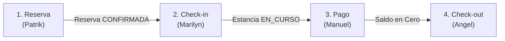
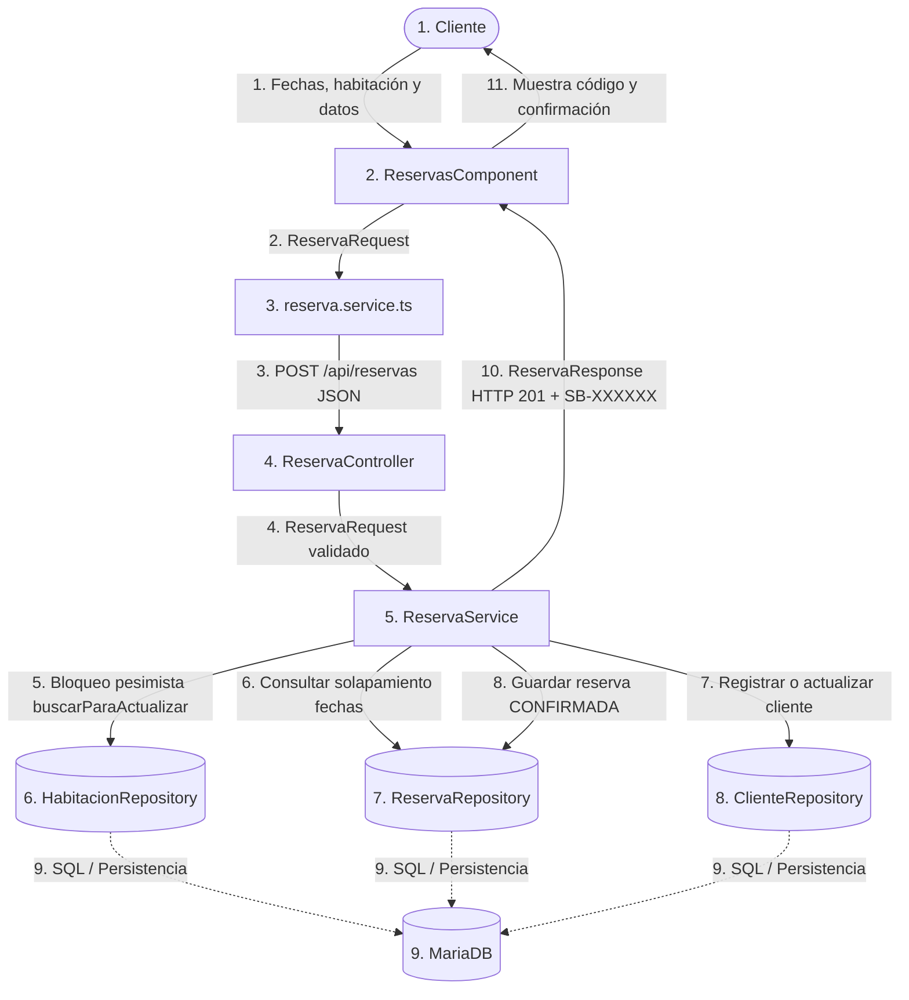
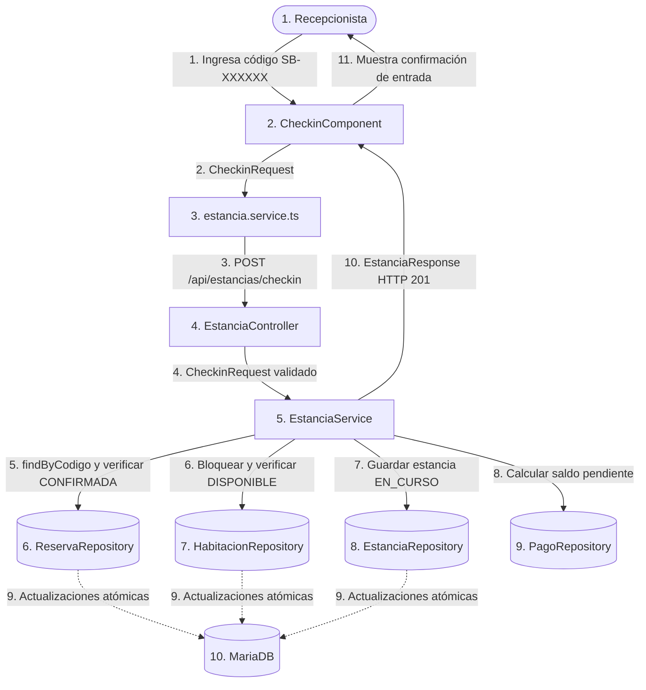
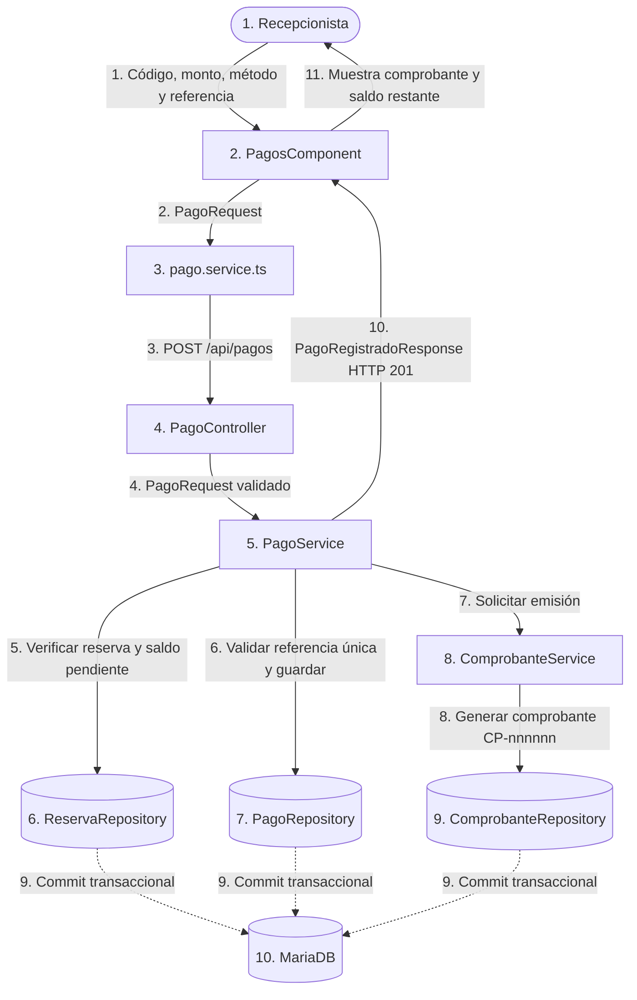

# Siball Hotel - Procesos de Negocio de Extremo a Extremo (E2E)

> **Documento y Guía del Proyecto para Exposición Grupal**  
> **Repositorio Oficial:** [https://github.com/xxLuis-Angelxx/ArquitecturaDeSoftware-Siball](https://github.com/xxLuis-Angelxx/ArquitecturaDeSoftware-Siball)

---

## 1. Información General del Proyecto

| Dato | Detalle |
| :--- | :--- |
| **Integrantes** | Patrik, Marilyn, Manuel y Angel |
| **Tecnologías** | Angular 21, Spring Boot 4.1.1 con Java 21 y MariaDB |
| **Arquitectura** | MVC en Capas (Frontend SPA + Backend RESTful) |
| **Repositorio** | [https://github.com/xxLuis-Angelxx/ArquitecturaDeSoftware-Siball.git](https://github.com/xxLuis-Angelxx/ArquitecturaDeSoftware-Siball.git) |

### Descripción General
**Siball Hotel** es una plataforma web integral diseñada para gestionar el ciclo completo de alojamiento de huéspedes: consulta y reserva de habitaciones, registro de llegada (*check-in*), registro de pagos y emisión de comprobantes, y salida (*check-out*).

Cada integrante del equipo lidera y expone uno de los cuatro procesos de negocio de extremo a extremo (E2E) que componen el ciclo de vida de una estancia:



---

## 2. Tabla de Integrantes y Procesos E2E

| Integrante | Proceso E2E | Inicio y Fin | Actores o Módulos Involucrados | Enlace al Diagrama |
| :--- | :--- | :--- | :--- | :--- |
| **Patrik** | **1. Reserva de habitaciones** | **Inicio:** Cliente solicita habitación y fechas.<br>**Fin:** Reserva `CONFIRMADA` persistida con código `SB-XXXXXX`. | Cliente, `ReservasComponent`, `reserva.service.ts`, `ReservaController`, `ReservaService`, `HabitacionRepository`, `ReservaRepository`, `ClienteRepository`, MariaDB. | [Ver Diagrama Proceso 1](#diagrama-t%C3%A9cnico---proceso-1-reserva-de-habitaciones) |
| **Marilyn** | **2. Registro de huéspedes y check-in** | **Inicio:** Huésped presenta código de reserva en recepción.<br>**Fin:** Estancia `EN_CURSO` registrada, habitación `OCUPADA` y reserva `EN_CURSO`. | Recepcionista, `CheckinComponent`, `estancia.service.ts`, `EstanciaController`, `EstanciaService`, `ReservaRepository`, `HabitacionRepository`, `EstanciaRepository`, `PagoRepository`, MariaDB. | [Ver Diagrama Proceso 2](#diagrama-t%C3%A9cnico---proceso-2-registro-de-hu%C3%A9spedes-y-check-in) |
| **Manuel** | **3. Pago y emisión de comprobante** | **Inicio:** Huésped solicita pagar su reserva.<br>**Fin:** Pago registrado, saldo actualizado y comprobante interno `CP-nnnnnn` emitido. | Recepcionista, `PagosComponent`, `pago.service.ts`, `PagoController`, `PagoService`, `ComprobanteService`, `ReservaRepository`, `PagoRepository`, `ComprobanteRepository`, MariaDB. | [Ver Diagrama Proceso 3](#diagrama-t%C3%A9cnico---proceso-3-pago-y-emisi%C3%B3n-de-comprobante) |
| **Angel** | **4. Check-out y cierre de estancia** | **Inicio:** Huésped solicita su salida del hotel.<br>**Fin:** Estancia `CERRADA`, reserva `FINALIZADA` y habitación en `PENDIENTE_LIMPIEZA`. | Recepcionista, `CheckoutComponent`, `estancia.service.ts`, `EstanciaController`, `EstanciaService`, `EstanciaRepository`, `PagoRepository`, `HabitacionRepository`, `ReservaRepository`, MariaDB. | [Ver Diagrama Proceso 4](#diagrama-t%C3%A9cnico---proceso-4-check-out-y-cierre-de-estancia) |

---

## 3. Arquitectura del Sistema (MVC en Capas)

El sistema implementa una clara separación de responsabilidades:

| Capa | Qué contiene | Ubicación en el Código |
| :--- | :--- | :--- |
| **Modelo** | Entidades JPA, Enumeraciones, Repositorios Spring Data, DTOs | `Siball/src/main/java/com/epiis/Siball/model/`<br>`Siball/.../repository/`<br>`Siball/.../dto/`<br>`frontend/src/app/core/models/` |
| **Vista** | Interfaces de usuario, componentes reactivos, formularios y estilos | `frontend/src/app/pages/`<br>(reservas, checkin, pagos, checkout, admin) |
| **Controlador** | Endpoints HTTP REST, mapeo de rutas, validación sintáctica DTO | `Siball/src/main/java/com/epiis/Siball/controller/` |
| **Servicios** | Lógica de negocio, reglas de validación, transacciones ACID | `Siball/src/main/java/com/epiis/Siball/service/` |

---

## 4. Detalle de Procesos de Negocio E2E

### PROCESO 1: RESERVA DE HABITACIONES
**Responsable:** Patrik

#### 1. Definición del Proceso
- **Evento de Inicio:** El cliente ingresa a la plataforma web, consulta habitaciones disponibles para un rango de fechas y selecciona la de su preferencia enviando sus datos personales.
- **Resultado Final:** Reserva registrada en MariaDB con estado `CONFIRMADA`, cliente asociado registrado/actualizado y generación del código único `SB-XXXXXX` con su importe total calculado.

#### 2. Diagrama Técnico - Proceso 1 (Reserva de habitaciones)



#### 3. Flujo Técnico Numerado
1. **Cliente → ReservasComponent:** El cliente selecciona las fechas de entrada/salida, elige una habitación y completa sus datos personales.
2. **ReservasComponent → reserva.service.ts:** El componente construye el objeto `ReservaRequest`.
3. **reserva.service.ts → ReservaController:** Envía petición HTTP `POST /api/reservas` con el cuerpo JSON.
4. **ReservaController → ReservaService:** El controlador valida los campos (`@Valid`) y delega la ejecución al servicio transaccional.
5. **ReservaService → HabitacionRepository:** Ejecuta bloqueo pesimista `SELECT ... FOR UPDATE` sobre la habitación mediante `buscarParaActualizar`.
6. **ReservaService → ReservaRepository:** Comprueba que no existan reservas en estados `CONFIRMADA` o `EN_CURSO` que se solapen con las fechas solicitadas.
7. **ReservaService → ClienteRepository:** Registra el cliente o recupera su información si ya existía en el sistema según su documento.
8. **ReservaService → ReservaRepository:** Calcula el importe total según la tarifa diaria y número de noches, guardando la reserva con estado `CONFIRMADA`.
9. **Repositorios → MariaDB:** Se ejecuta el commit de la transacción en las tablas `habitaciones`, `clientes` y `reservas`.
10. **Backend → Frontend:** Se retorna `ReservaResponse` con código `HTTP 201`, código `SB-XXXXXX` y total a pagar.

#### 4. Recorrido de un Dato: `fecha_entrada`
1. El cliente la elige en el formulario de Angular (`ReservasComponent`).
2. Se asigna a `ReservaRequest.fechaEntrada` y se envía por HTTP POST.
3. `ReservaService.validarFechas()` comprueba que no sea anterior a la fecha actual y que la salida sea posterior.
4. Se utiliza como parámetro de solapamiento en `ReservaRepository.buscarSolapamientos()`.
5. Se almacena en la columna `reservas.fecha_entrada` en MariaDB.

#### 5. Decisiones Técnicas y Manejo de Errores
- **Decisión Técnica:** Uso de **bloqueo pesimista** (`PESSIMISTIC_WRITE` con `SELECT ... FOR UPDATE`) sobre la habitación. Se descartó la consulta simple sin bloqueo porque provocaría condiciones de carrera (*overbooking*) ante peticiones concurrentes simultáneas.
- **Manejo de Errores:**
  - Fechas inválidas o en el pasado: `400 Bad Request`.
  - Habitación inexistente: `404 Not Found`.
  - Cruce de fechas / No disponible: `409 Conflict`.
  - Fallo en BD: Transacción revertida vía `@Transactional` y respuesta `503 Service Unavailable`.

---

### PROCESO 2: REGISTRO DE HUÉSPEDES Y CHECK-IN
**Responsable:** Marilyn

#### 1. Definición del Proceso
- **Evento de Inicio:** El huésped se presenta físicamente en la recepción del hotel y proporciona su código de reserva (`SB-XXXXXX`).
- **Resultado Final:** Se registra la estancia en estado `EN_CURSO`, la habitación pasa a estado `OCUPADA` y la reserva se actualiza a `EN_CURSO`.

#### 2. Diagrama Técnico - Proceso 2 (Check-in)



#### 3. Flujo Técnico Numerado
1. **Recepcionista → CheckinComponent:** El recepcionista digita o selecciona el código de la reserva.
2. **CheckinComponent → estancia.service.ts:** Se genera la solicitud `CheckinRequest(codigo)`.
3. **estancia.service.ts → EstanciaController:** Petición HTTP `POST /api/estancias/checkin`.
4. **EstanciaController → EstanciaService:** Petición recibida y delegada al servicio transaccional.
5. **EstanciaService → ReservaRepository:** Se busca la reserva y se valida que su estado sea estrictamente `CONFIRMADA`. Pasa a `EN_CURSO`.
6. **EstanciaService → HabitacionRepository:** Se bloquea la habitación, se comprueba que esté en estado `DISPONIBLE` y se actualiza a `OCUPADA`.
7. **EstanciaService → EstanciaRepository:** Se crea una nueva entidad `Estancia` vinculada a la reserva, con fecha/hora de ingreso real y estado `EN_CURSO`.
8. **EstanciaService → PagoRepository:** Se consultan los pagos ya efectuados para calcular el saldo pendiente informativo.
9. **Repositorios → MariaDB:** La transacción asegura la consistencia atómica de la estancia, habitación y reserva.
10. **Backend → Frontend:** Se responde con `EstanciaResponse` (`HTTP 201`) con los datos de ingreso y saldo restante.

#### 4. Recorrido de un Dato: `codigo_reserva`
1. Introducido en el input de `CheckinComponent`.
2. Enviado en el payload de `POST /api/estancias/checkin`.
3. Utilizado en `ReservaRepository.findByCodigo()` para traer la reserva y sus datos.
4. Vinculado por clave foránea `reserva_id` en el nuevo registro de `estancias`.

#### 5. Decisiones Técnicas y Manejo de Errores
- **Decisión Técnica:** Separación de la entidad **Estancia** de la entidad **Reserva**. La reserva representa la planificación previa, mientras que la estancia representa la ocupación real en sitio. Se descartó reutilizar únicamente un flag en la reserva para permitir auditoría precisa de horas reales de entrada/salida.
- **Manejo de Errores:**
  - Código inexistente: `404 Not Found`.
  - Reserva no confirmada (ya ingresada, cancelada o finalizada): `409 Conflict`.
  - Habitación no disponible: `409 Conflict`.
  - Error en base de datos: Rollback completo y `503`.

---

### PROCESO 3: PAGO Y EMISIÓN DE COMPROBANTE
**Responsable:** Manuel

#### 1. Definición del Proceso
- **Evento de Inicio:** El huésped solicita realizar un abono o liquidar el saldo de su estancia en recepción.
- **Resultado Final:** Pago registrado en MariaDB, saldo recalculado (`PENDIENTE`, `PARCIAL` o `PAGADO`) y emisión del comprobante interno con código `CP-nnnnnn`.

#### 2. Diagrama Técnico - Proceso 3 (Pago y Comprobante)



#### 3. Flujo Técnico Numerado
1. **Recepcionista → PagosComponent:** Se consulta la reserva para visualizar el saldo pendiente; se ingresa el monto a abonar, método (efectivo, tarjeta, transferencia) y referencia.
2. **PagosComponent → pago.service.ts:** Prepara el DTO `PagoRequest`.
3. **pago.service.ts → PagoController:** Envía HTTP `POST /api/pagos`.
4. **PagoController → PagoService:** Valida montos mayores a cero (`@DecimalMin("0.01")`) y delega.
5. **PagoService → ReservaRepository:** Obtiene la reserva y verifica que no esté totalmente liquidada; si el nuevo abono completa el total, actualiza `estado_pago = PAGADO`, de lo contrario `PARCIAL`.
6. **PagoService → PagoRepository:** Valida que no exista duplicidad de referencia y almacena el registro en la tabla `pagos`.
7. **PagoService → ComprobanteService:** Invoca la emisión automática del comprobante asociado.
8. **ComprobanteService → ComprobanteRepository:** Persiste el comprobante interno asignando correlativo `CP-` seguido del ID del pago.
9. **Repositorios → MariaDB:** Persistencia conjunta y atómica de pago, comprobante y estado de la reserva.
10. **Backend → Frontend:** Retorna `PagoRegistradoResponse` con HTTP 201 indicando saldo restante y código de comprobante.

#### 4. Recorrido de un Dato: `monto`
1. Capturado en el formulario de `PagosComponent`.
2. Validado en `PagoRequest` como `@NotNull` y `@DecimalMin("0.01")`.
3. `PagoService` comprueba que `monto <= saldoPendiente`.
4. Se almacena como `BigDecimal` con 2 decimales en `pagos.monto`.
5. Se copia en `comprobantes.monto` para respaldar la transacción económica.

#### 5. Decisiones Técnicas y Manejo de Errores
- **Decisión Técnica:** Manejo de importes mediante **`BigDecimal`** con escala monetaria fija y **restricción de unicidad** en la columna de referencia para evitar pagos duplicados accidentales. Se descartó integrar pasarela bancaria externa para mantener el MVP autocontenido y sin dependencias externas que puedan fallar en una demo.
- **Manejo de Errores:**
  - Monto cero o negativo: `400 Bad Request`.
  - Monto mayor al saldo pendiente: `400 Bad Request` indicando el límite exacto.
  - Referencia de pago duplicada: `409 Conflict`.
  - Reserva no encontrada o no apta: `404 Not Found` / `409 Conflict`.

---

### PROCESO 4: CHECK-OUT Y CIERRE DE ESTANCIA
**Responsable:** Angel

#### 1. Definición del Proceso
- **Evento de Inicio:** El huésped notifica en recepción que concluye su estancia y desea retirarse del hotel.
- **Resultado Final:** Se valida que no exista deuda (saldo = 0), la estancia se marca `CERRADA`, la reserva pasa a `FINALIZADA` y la habitación pasa a `PENDIENTE_LIMPIEZA`.

#### 2. Diagrama Técnico - Proceso 4 (Check-out)

```mermaid
flowchart TD
    A([1. Recepcionista]) -->|1. Selecciona estancia a cerrar| B[2. CheckoutComponent]
    B -->|2. Identificador de estancia| C[3. estancia.service.ts]
    C -->|3. POST /api/estancias/{id}/checkout| D[4. EstanciaController]
    D -->|4. ID de estancia recibido| E[5. EstanciaService]
    E -->|5. Verificar existencia y estado EN_CURSO| F[(6. EstanciaRepository)]
    E -->|6. Verificar saldo pendiente igual a 0| G[(7. PagoRepository)]
    E -->|7. Actualizar habitación a PENDIENTE_LIMPIEZA| H[(8. HabitacionRepository)]
    E -->|8. Actualizar reserva a FINALIZADA| I[(9. ReservaRepository)]
    F -.->|9. Transacción cerrada| J[(10. MariaDB)]
    G -.->|9. Transacción cerrada| J
    H -.->|9. Transacción cerrada| J
    I -.->|9. Transacción cerrada| J
    E -->|10. EstanciaResponse HTTP 200| B
    B -->|11. Notificación de salida exitosa| A
```

#### 3. Flujo Técnico Numerado
1. **Recepcionista → CheckoutComponent:** Visualiza las estancias activas mediante `GET /api/estancias?estado=EN_CURSO` y selecciona la estancia a cerrar.
2. **CheckoutComponent → estancia.service.ts:** Envía el ID de la estancia seleccionada.
3. **estancia.service.ts → EstanciaController:** Petición HTTP `POST /api/estancias/{id}/checkout`.
4. **EstanciaController → EstanciaService:** Se delega la lógica de cierre de salida.
5. **EstanciaService → EstanciaRepository:** Se verifica que la estancia exista y esté en estado `EN_CURSO`.
6. **EstanciaService → PagoRepository:** Se suman los pagos efectuados. **Regla estricta:** Si `saldoPendiente > 0`, se rechaza inmediatamente la salida.
7. **EstanciaService → HabitacionRepository:** La habitación pasa a estado `PENDIENTE_LIMPIEZA` (no a DISPONIBLE).
8. **EstanciaService → ReservaRepository:** La reserva vinculada cambia a estado `FINALIZADA`.
9. **Repositorios → MariaDB:** Se confirman los cambios atómicos en las 3 tablas.
10. **Backend → Frontend:** Retorna `EstanciaResponse` con `HTTP 200`.

#### 4. Recorrido de un Dato: `estancia_id`
1. Proviene de la fila seleccionada en la tabla interactiva de `CheckoutComponent`.
2. Viaja como variable de ruta en la URL: `/api/estancias/{id}/checkout`.
3. Es capturado por el controlador con `@PathVariable Long id`.
4. `EstanciaService` invoca `EstanciaRepository.findById(id)` para iniciar las validaciones de negocio.

#### 5. Decisiones Técnicas y Manejo de Errores
- **Decisión Técnica:** Transición obligatoria a **`PENDIENTE_LIMPIEZA`**. Se descartó pasar la habitación inmediatamente a `DISPONIBLE` porque el personal de limpieza requiere un flujo independiente para acondicionar el cuarto antes de volver a asignarlo a un nuevo huésped.
- **Manejo de Errores:**
  - Estancia inexistente: `404 Not Found`.
  - Estancia no está en curso (ya cerrada): `409 Conflict`.
  - Saldo adeudado pendiente: `409 Conflict` detallando el monto exacto por cancelar antes de permitir el retiro.
  - Fallo en base de datos: Rollback total de la operación sin alterar los estados.

---

## 5. Guía de Instalación y Ejecución Local

### Prerrequisitos
- **Java:** OpenJDK 21 LTS
- **Node.js:** v20+ o v22+
- **Gestor de BD:** MariaDB / MySQL en puerto `3306` (Base de datos: `siball`, usuario: `root`, sin contraseña) o XAMPP.

### Paso 1: Configurar Base de Datos
Asegúrate de que MySQL/MariaDB esté activo en el puerto 3306 y crea la base de datos:
```sql
CREATE DATABASE IF NOT EXISTS siball;
```

### Paso 2: Iniciar Backend (Spring Boot)
Abre una terminal en la carpeta `Siball`:
```powershell
cd Siball
.\mvnw.cmd spring-boot:run
```
*El backend quedará escuchando en `http://localhost:8080` (las tablas y datos base se inicializan automáticamente).*

### Paso 3: Iniciar Frontend (Angular)
Abre otra terminal en la carpeta `frontend`:
```powershell
cd frontend
npm install
npm start
```
*El frontend quedará activo en `http://localhost:4200`.*

---

## 6. Demostración del Recorrido Completo E2E

Para validar el ciclo de vida continuo del hotel en vivo:
1. **Crear Reserva (Patrik):** Entrar a `http://localhost:4200/reservas`, elegir fechas y habitación, completar datos del cliente y anotar el código generado (ej. `SB-123456`).
2. **Realizar Check-in (Marilyn):** Ir a la sección Check-in, ingresar el código `SB-123456` y confirmar el ingreso del huésped. La habitación pasará a `OCUPADA`.
3. **Efectuar Pago (Manuel):** Ir a la sección Pagos, buscar la reserva, verificar el saldo y abonar el monto total. Se generará el comprobante `CP-xxxxxx`.
4. **Realizar Check-out (Angel):** Ir a la sección Check-out, seleccionar la estancia activa y dar clic en Confirmar Salida. El sistema valida saldo cero y transiciona la habitación a `PENDIENTE_LIMPIEZA`.
